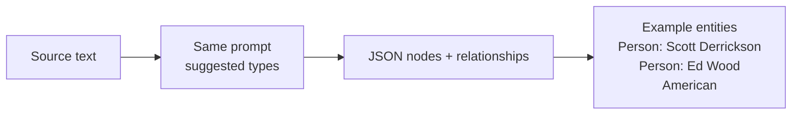
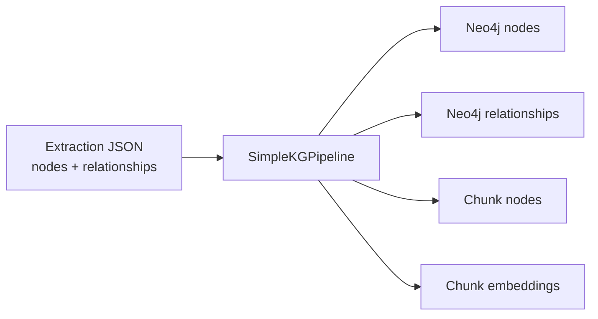
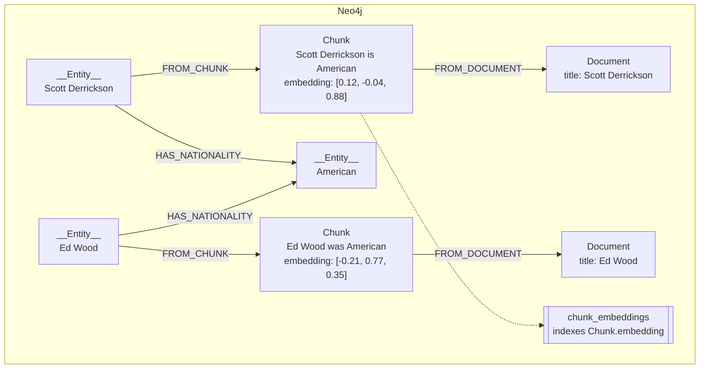

# Agentic Hybrid RAG

How the method builds its graph, how the agent retrieves evidence, and which
scores the Streamlit app shows. Code: `graphrag_construction.py` (ontology and
graph build) and `graphrag_retrieval.py` (agent, tools and answer flow). The
reported research results and how they are scored are in the
[README](../README.md#how-answers-and-retrieval-are-scored); the exact prompts
are on slide 02 of the Experiments scene.

## Graph construction

Graph construction turns shared source chunks into extracted entities,
relationships, and embeddings. `GraphRAG.construct()` receives source pages
and splits each page on its own with the benchmark's title-prefixed 256-token
`SentenceSplitter` (20-token overlap), so chunks are identical to the other
methods' chunks and every chunk knows its page.

### The whole flow

Ontology-guided construction receives source pages and passes the ontology
schema and prompt to the extractor.

```mermaid
flowchart LR
    input["Source pages"] --> guided["Ontology-guided<br/>extract with suggested types"]
    guided --> extracted["Extraction JSON<br/>nodes + relationships"]
    extracted --> pipeline["SimpleKGPipeline<br/>builds the graph"]
    pipeline --> graph["Graph + chunks<br/>and embeddings"]
    graph --> neo4j["Neo4j<br/>graph + vectors"]
```

### One example

Repeated extracted properties other than `name` retain their distinct values
as a list. When a list mixes types, the adapter converts its values to text
because Neo4j requires each stored property array to contain one type. `name`
is always a single string: when the model returns several names or a list, the
first is the name and the rest go to an `aliases` list.

The question is used later for retrieval and evaluation. Construction receives
only the source pages.

```text
Question (not construction input):
Were Scott Derrickson and Ed Wood of the same nationality?

Source pages:
Scott Derrickson was an American director, screenwriter, and producer.
Ed Wood was an American filmmaker, actor, writer, producer, and director.
```

#### Ontology-guided extraction

Ontology-guided passes suggested node and relationship types. It can return
additional types.



The diagrams show the extraction stage, not the exact output for every run.

### Prompts sent to the extractor

Ontology-guided extraction starts with this prompt. `SimpleKGPipeline` fills `{schema}`, `{examples}`,
and `{text}`.

```text
You are a top-tier algorithm designed for extracting
information in structured formats to build a knowledge graph.

Extract the entities (nodes) and specify their type from the following text.
Also extract the relationships between these nodes.

Return result as JSON using the following format:
{{"nodes": [ {{"id": "0", "label": "Person", "properties": {{"name": "John"}} }}],
"relationships": [{{"type": "KNOWS", "start_node_id": "0", "end_node_id": "1", "properties": {{"since": "2024-08-01"}} }}] }}

Use only the following node and relationship types (if provided):
{schema}

Assign a unique ID (string) to each node, and reuse it to define relationships.
Do respect the source and target node types for relationship and
the relationship direction.

Make sure you adhere to the following rules to produce valid JSON objects:
- Do not return any additional information other than the JSON in it.
- Omit any backticks around the JSON - simply output the JSON on its own.
- The JSON object must not wrapped into a list - it is its own JSON object.
- Property names must be enclosed in double quotes

Examples:
{examples}

Input text:

{text}
```

`[graphrag] ontology` in `config.toml` picks the ontology. The default,
`general`, is used for every dataset and passes these suggested types through
`{schema}`:

```text
Node types:
Person, Organization, Place, Event, Work, Concept, Thing

Relationship types:
MEMBER_OF, WORKS_FOR, LOCATED_IN, PART_OF, CREATED, PARTICIPATED_IN, RELATED_TO

Additional node and relationship types: allowed
```

`dataset` keeps the earlier per-dataset ontologies: the biography ontology
(Person, Organization, Place, CreativeWork, Event, Concept, Thing; BORN_IN,
MEMBER_OF, CREATED_BY and others) for HotpotQA and other datasets, and the news
ontology for MultiHop-RAG. The chosen ontology is part of the graph index key,
so switching it builds a new graph instead of reusing an old one.
The news ontology exists because the biography ontology had no article, outlet, or date types: on MultiHop-RAG 21% of entities fell back to Thing and 254 ad hoc relationship types appeared, while each chunk starts with "Title (Outlet, date)".

The Ontology-guided method appends these rules to the shared prompt:

```text
Rules:
- Every node needs a name.
- Fill a field only when text states it. Omit it when not stated.
- Use Thing only when no narrower kind fits.
- Link name is UPPER_SNAKE, short, from text.
- One fact per link. No facts outside text.
```

The structured-output adapter then appends this instruction:

```text
Extract the entities and relationships only from the Input text section of
the preceding message, never from formatting examples, using the response
schema. Encode each node's and relationship's properties as a list of
entries, or an empty list when there are none. In each entry, key is the
property name in lower_snake_case, such as name, aliases, or occupation,
and value is the stated fact. Every node has exactly one name entry whose
value is a single string: the entity's main name. Put other names for the
same entity in one aliases entry whose value is a list of strings. When any
other property has several stated values, give them as one list value.
```

The adapter drops property entries whose key is empty, `key`, `value`, starts
with `key` followed by a non-letter (such as `key_DO_NOT_USE` or `key1`),
contains a space, colon, or question mark, starts with `__`, or is
`embedding`. A pair such as `{key: "key", value: "kind"}`,
`{key: "value", value: "company"}` is joined back into `kind = "company"`.
Nodes with no name are dropped with their relationships.

### Build the graph



### Neo4j graph and vector storage

Neo4j can store the extracted graph and the vectors used to search its chunks.
The vectors below are shortened examples.



The active construction path creates a Neo4j database per run and source
corpus. HotpotQA questions share the loaded corpus; other datasets use each
record's source pages. Each database stores chunk vectors in Neo4j. The
`chunk_embeddings` index supports the agent's vector tool.

Neo4j provides both vector search and graph context for agentic retrieval.

Before the pipeline runs, `rebuild_graph()` creates the `__tmp_internal_id` index in the target database because the library creates it only in the default database; without it the MultiHop-RAG relationship write ran at about 1k per minute instead of about 120k.

### After the pipeline writes

`rebuild_graph()` runs these steps in the target database once the pipeline
has written chunks and entities:

1. Clear `__tmp_internal_id` and drop its index. The library's own cleanup
   runs without a database argument, so it cleaned the default database and
   left about 40,000 temporary ids in each benchmark graph.
2. Replace the pipeline's single inline `document.txt` Document with one
   `Document` per source page (`title` and `name` are the page title as
   given), link each chunk to its page with `FROM_DOCUMENT`, and delete
   `NEXT_CHUNK` links between chunks of different pages. Before this, one
   Document held every page and `NEXT_CHUNK` joined unrelated pages.
3. Merge entities with the same primary label and the same
   `toLower(trim(name))` using `apoc.refactor.mergeNodes` (first node is the
   most connected one; its properties win, missing ones are filled from the
   others; aliases are combined; relationships are kept and duplicates
   merged; self-loops created by the merge are removed). Exact-match
   resolution left 513 case-variant groups such as `CNBC` / `Cnbc` in the
   MultiHop-RAG graph. The library's exact-match resolver is turned off
   because this step covers it.
4. Print to stderr how many chunks have no extracted entity. The MultiHop-RAG
   news graph had 230 of 7,728.
5. Create the `chunk_embeddings` vector index and wait up to
   `[graphrag] index_timeout` seconds for it.

### Construction requests and restarts

A rebuild runs `CREATE OR REPLACE DATABASE ... WAIT`, so a retry after a
failed or partial write starts from an empty database instead of adding a
second copy of every node.

Before the pipeline starts, all chunks are embedded in batches of 512 texts
per OpenAI embeddings request with the configured model and dimensions. The
vectors are stored in an `embeddings` table in the same SQLite file as the
generation cache (`runs/graphrag/construction-cache/<database>.sqlite`),
keyed by sha256 of model, dimensions and text. The pipeline's embedder then
answers from that table and calls the API only on a miss. The pipeline used
to send one request per chunk, five at a time, and re-embedded everything on
every restart.

neo4j-graphrag wraps embedders and LLMs in a tenacity retry handler by
default. RecRAG passes `NoOpRateLimitHandler` to both, and its OpenAI clients
use `max_retries=0`, so the only retry policy is the one in `AGENTS.md`.

Successful extraction calls are cached in the `chat_generations` table of the
same file. The cache key is the prompt plus a construction identity: chat
model, reasoning effort, chat endpoint override, embedding model and
dimensions, chunking, ontology, extraction prompt, adapter instruction,
extraction response schema, and the neo4j-graphrag version. It no longer
uses LangChain's model string, which included timeouts, so changing
`[llm] timeout` mid-build used to discard every cached extraction. The
benchmark's Agentic Hybrid RAG index key uses the same identity plus the
corpus hash, for the same reason. These key changes mean graphs and caches
built before 2026-11-01 are not reused.

When a cached reply fails to parse or validate, its entry is deleted and the
model is called once more. Before, a bad cached reply failed the build on
every resume. A fresh reply that fails still fails the build.

Neo4j driver connections use `[graphrag] timeout` (30 s), which also bounds
the schema queries made for text-to-Cypher.

## Retrieval

Agentic Hybrid RAG retrieves only through its agent. `GraphRAG.answer()` and the
benchmark both use `GraphRAG.retriever(database)`, which builds the agent and
its tools once per database and reuses them for later questions in the same
process. A rebuild of that database drops the cached agent and schema.

The agent chooses between two tools:

| Tool | Implementation | Evidence |
| --- | --- | --- |
| `vector_search` | Neo4j `VectorCypherRetriever` over `chunk_embeddings` | Chunk text, its page title, up to 15 names of entities it mentions, and up to 5 facts written `A -REL-> B`. |
| `cypher_search` | Neo4j `Text2CypherRetriever` with a bounded runner | Up to 10 rows returned by a generated read-only Cypher query. |

These are internal tools, not standalone retrieval methods.

### Agent and answer flow

1. Build (or reuse) the agent and its tools for the target database.
2. Run the LangChain agent with both tools and a five-model-call limit.
3. Every result line carries a tag (`E` plus 6 hex characters of its text's
   sha256). The agent ends by listing the tags of the results the answer
   needs, at most 10. Those go first, in its order; the remaining slots take
   `vector_search` passages by best similarity score, then `cypher_search`
   rows, up to `top_k`. If the agent names no valid tag, that order fills all
   `top_k`.
4. Pass those items to the official `neo4j-graphrag` answer flow. A passage is
   sent as its plain text, like Normal RAG's chunks; its entities and facts
   stay in the saved evidence only.
5. Return the answer and retrieved context for display and optional evaluation.

`top_k` is 10 everywhere (`RETRIEVAL_TOP_K`, matching the benchmark's
`--topk` default). Each `vector_search` call returns 10 passages; the agent
can no longer set that number. The tool schema now has only `query_text`,
because the agent used to pass its own `top_k`, filters, and vectors.

The agent is instructed to call one tool before answering, refine its search
when evidence is insufficient, and avoid repeating searches with no new evidence.
It chooses tools only from their descriptions; it never sees the database
schema. The Cypher tool description names the ontology's node types because,
with only "Generate and run a read-only Cypher query," the agent picked vector
search on all 15 questions of a MultiHop-RAG rerun (2026-10-31) and never tried
Cypher. Before the latest run, code picked the 10 items by a fixed rule and
ignored the agent's own view of what mattered; why that changed is in
`runs/agentic_tune/agent_picks/README.md`.

### Vector evidence

Each vector result is a JSON object with `title`, `text`, `entities` and
`facts`. It used to carry up to 25 one- or two-hop graph paths as nested
JSON, about 10,000 characters per passage, which made Agentic Hybrid RAG's
context ten times larger than the other methods'. A record is now about
1,600 characters. Facts are taken from at most 10 relationships per mentioned
entity, preferring links that reach an entity outside the passage, since
facts between two entities of the same passage repeat the text. On the
MultiHop-RAG graph the query took 0.1 s for the 10 densest chunks.

`evals.retrieval_judge` still renders the old `graph_facts` shape as graph
facts. New records do not match that shape, so the judge falls back to
listing their fields as a row; `evals.retrieval_quality` reads only `text`
and is unaffected.

### Text-to-Cypher

The schema given to the Cypher generator is built from
`get_structured_schema` and filtered: properties starting with `__`,
`embedding`, junk keys (the same rule the construction adapter uses), and
entity or relationship properties used by fewer than 3 nodes or 1% of their
label are left out, and `__Entity__ {name, aliases}` is listed because the
examples use it. On the old MultiHop-RAG graph, Organization went from 30
listed properties to 2. The formatted schema is cached per database.

The prompt adds these rules: use only listed labels, types and properties;
match names case-insensitively with `toLower` on `name` and each alias;
return graph facts only (names, titles, dates, short properties, relationship
types), never passage text, since `vector_search` finds passages; write
alternative types as `[:A|B]`; return at most 10 rows. Code backs this up: a
query that reads `.text` is refused, `text` and `embedding` keys are dropped
from rows, and lists keep at most 20 items. In the previous run the rule was
to find passages through `FROM_CHUNK`, and graph rows had no size limit. Examples use only
labels and types from the general ontology. Names are now always strings,
so the examples no longer need the list-or-string alias workaround.

Each generated query runs in an explicit read transaction with the
`[graphrag.retrieval] timeout` (10 s): `EXPLAIN` first, refusal of anything
that is not read-only, at most 10 rows fetched, then rollback. A forced run
once stalled for 46 minutes on one question with no time limit. Statement
errors, transaction timeouts and `Neo.TransientError.General.MemoryPool*`
errors go back to the agent as tool errors that include the generated
Cypher, so it can fix the query; connection and auth errors still end the run.
The explicit transaction is not retried by the driver. In the latest run 7.4%
of generated queries failed this way and 24.5% returned no rows; causes are in
`runs/final500/cypher_failures/SUMMARY.md`.

Cypher rows have no similarity score. The benchmark's shared result record
needs one float per passage, so they are saved as `-1.0`, outside the
vector score range of 0 to 1, instead of a `0.0` that looks like a real
score. Vector results keep their similarity score.

The configured LangChain chat model drives the agent. `GraphRAGChatLLM` adapts
that model for text-to-Cypher generation and the final answer. Generation uses
`gpt-6-luna` with medium reasoning through the Responses API.

### Inputs and results

`GraphRAG.answer(question, database=...)` returns one `RagResultModel`.

Each result contains `answer` and `retriever_result`. Evidence items contain
serialized Neo4j records and tool metadata. Answer generation and retrieval
evaluation use the same ten-item context limit.

When no context is found, the answer fallback is:

> I could not find supporting context for this question.

### Adapter notes

- `AGENT_INSTRUCTION` and `TOOL_PURPOSE` are module-level so experiment scripts can swap the agent instruction without editing the module; the benchmark always uses the default.
- The benchmark checks `SHOW DATABASES` as well as the local `graph.complete` marker, because the marker alone does not prove the Desktop database still exists.
- Embedder `async_embed_query` runs the sync call in a thread, because the upstream async default calls synchronous HTTP on the event loop and serializes the pipeline's concurrent chunk embedding.
- Extraction asks for properties as a list of key/value entries because strict structured output cannot express arbitrary property maps; the entries carry the same facts.
- The generation cache stores each reply as Pydantic JSON; structured parsed responses serialize as JSON objects, which LangChain's parser accepts on cache hits.

### Tool-order study (2026-10-31)

Same 40 MultiHop-RAG questions (first 20 comparison, first 20 temporal) on
the Oct 18 graph, which was built from 1,000-character chunks, not the shared
256-token chunks. Scored by answer overlap.

| Instruction | Comparison | Temporal | Cypher evidence reached answer | Cost | Mean retrieval |
| --- | --- | --- | --- | --- | --- |
| Free choice (default) | 13/20 | 10/20 | 0 of 40 questions | $0.205 | 14 s |
| Vector first, Cypher once, then free | 15/20 | 12/20 | 5 of 40 questions | $0.243 | 33 s |

Forced order won 6 questions and lost 2. Only 1 of the 6 wins had Cypher
evidence in the final context; the rest differ by a few vector passages and
answer variance, so this gap may be chance. Under free choice the agent never
called Cypher. Run alone on the question text, generated Cypher returned no rows
on most questions. The likely causes: one Document holds all 609 articles, so
outlet and date live only in each article's first chunk; there are only two
`PUBLISHED_BY` edges; and generated queries require every clause of the
question at once. One forced run stalled for 46 minutes on a single question
with no query time limit, and the stall did not recur on rerun.

Rerun after fixing the Cypher tool wiring (generated query and row count
returned to the agent, examples in the documented `USER INPUT` / `QUERY`
format, parameter descriptions, a tool-purpose sentence in the instruction;
same full schema, same graph):

| Instruction | Comparison | Temporal | Cypher evidence reached answer | Cost | Mean retrieval |
| --- | --- | --- | --- | --- | --- |
| Free choice | 15/20 | 12/20 | 0 of 40 questions | $0.208 | 12 s |
| Vector first, Cypher once, then free | 13/20 | 11/20 | 11 of 40 questions | $0.308 | 28 s |

Across the four 40-question runs, totals ranged from 23 to 27 with no
consistent winner, so differences of this size are run-to-run noise. Fixing
the wiring doubled how often graph evidence reached the answer (5 → 11), but
that evidence was mostly passages the vector tool also finds or generic links
such as `Baltimore Ravens PART_OF AFC North`. The graph lacks the outlet and
date facts these questions turn on, so better querying alone does not help.

### News ontology rebuild (2026-11-01)

MultiHop-RAG now has its own ontology (`NEWS_ONTOLOGY_SCHEMA`: Article,
Publisher, Person, Organization, Product, Event, Place, Topic; PUBLISHED_BY,
MENTIONS and 10 more), and the graph was rebuilt on the shared 256-token chunks
(20 overlap). HotpotQA keeps the biography ontology. Same 40 questions, same
agent and tools as the tool-order study; the earlier scores are saved under
`runs/baselines/multihop-biography-ontology-20261031/`.

| Graph | Entities | Thing | Relationship types | Entity links | PUBLISHED_BY | Isolated entities |
| --- | --- | --- | --- | --- | --- | --- |
| Biography ontology, 1,000-char chunks | 30,165 | 21% | 261 | 11,524 | 2 | 18,037 |
| News ontology, 256-token chunks | 35,552 | 6% | 12 | 67,237 | 795 | 30 |

| Instruction | Graph | Comparison | Temporal | Total | Cypher evidence reached answer | Cost | Mean retrieval | Mean context tokens |
| --- | --- | --- | --- | --- | --- | --- | --- | --- |
| Free choice | biography | 15/20 | 12/20 | 27/40 | 0 of 40 | $0.208 | 12 s | 15,600 |
| Free choice | news | 11/20 | 12/20 | 23/40 | 2 of 40 | $0.316 | 13 s | 24,700 |
| Vector first, Cypher once | biography | 13/20 | 11/20 | 24/40 | 11 of 40 | $0.308 | 28 s | 13,900 |
| Vector first, Cypher once | news | 10/20 | 13/20 | 23/40 | 19 of 40 | $0.313 | 28 s | 22,700 |

The graph is now well formed: entities are linked, Thing is rare, and
generated Cypher returns article, outlet and date rows. Scores did not move
beyond run-to-run noise (about ±4 on 40 questions; free choice won 5 and lost
9 questions, forced order won 4 and lost 5). The likely reason: every chunk
already starts with `Title (Outlet, date)`, so vector passages carry the same
outlet and date facts the graph adds. Under free choice the agent still calls
Cypher rarely (graph evidence reached 2 answers). Context grew by about 60%,
likely because vector results now list many more linked entities per passage.

Build notes: `Neo4jWriter._db_setup` creates its `__tmp_internal_id` index
without a database argument, so it lands in the default database and the
relationship write ran at about 1,000 per minute; `rebuild_graph` now creates
it in the target database (about 120,000 per minute). The construction cache
key includes every chat-model setting, so changing `[llm] timeout` mid-build
discards all cached extractions.

#### All four methods and three tool orders on the same 40 questions (2026-11-01)

RAG, RAPTOR and HippoRAG were re-answered from their saved 2026-10-12
retrievals with the current answer prompt (it gained the "Yes or No only" rule
on 2026-10-21), so every row uses the same answer step. Retrieval is judged by
`evals.retrieval_judge` (answer-support score; gold-sentence recall second).

| Method | Comparison /20 | Temporal /20 | Total /40 | Judge support | Gold recall | Cost per question | Retrieval latency | Context tokens |
| --- | --- | --- | --- | --- | --- | --- | --- | --- |
| RAG | 8 | 10 | 18 | 59.2% | 43.3% | $0.0003 | 0.7 s | 2,300 |
| RAPTOR | 7 | 8 | 15 | 52.5% | 42.5% | $0.0003 | 0.6 s | 2,200 |
| HippoRAG | 8 | 10 | 18 | 52.5% | 43.3% | $0.0008 | 7.1 s | 2,300 |
| Agentic Hybrid RAG, news graph, free choice | 11 | 12 | 23 | 65.0% | 51.7% | $0.0079 | 12.5 s | 24,700 |
| ..., vector then Cypher (run 1) | 10 | 13 | 23 | 66.7% | 46.7% | $0.0078 | 28.1 s | 22,700 |
| ..., vector then Cypher (run 2) | 13 | 14 | 27 | 65.8% | 46.7% | $0.0080 | 27.0 s | 23,900 |
| ..., Cypher then vector | 13 | 11 | 24 | 69.2% | 50.8% | $0.0080 | 26.2 s | 21,000 |
| ..., Cypher only | 3 | 6 | 9 | 33.3% | 25.8% | $0.0041 | 39.6 s | 3,000 |

Index builds (one-off, MultiHop-RAG): RAG $0.03, RAPTOR $0.40, HippoRAG $5.49,
Agentic Hybrid RAG about $3.80 (old graph; the news build made a similar number
of extraction calls but its token usage was not cached).

Every Agentic Hybrid RAG variant with vector search beats the other three methods
by 5 to 12 questions and on the judge, at about 25 times RAG's per-question
cost and 20 to 40 times its latency, with ten times the context. Cypher alone
scores 9/40, so the lead comes from the agentic vector path (more and larger
passages, repeated searches), not from the graph. Two identical vector-then-
Cypher runs scored 23 and 27, which is the run-to-run noise.

Traced Cypher calls: roughly 40% fail and another quarter return no rows. Of
the failures, most are `toLower` on a list-valued `name` (88 entities have a
list name such as `["All Blacks", "New Zealand"]` while the schema reports
STRING), the rest syntax errors and one out-of-memory chunk scan. The causes are
in our extraction adapter, not the model: it merges repeated `name` entries
into an array, and its instruction "Do not use key or value as property names"
is echoed back as ~200 junk property keys such as `key_DO_NOT_USE`. Per-chunk
extraction also cannot see that "CNBC" and "Cnbc | World Business News
Leader" are one outlet (315 Publisher nodes for 49 outlets), and exact-match
entity resolution leaves 514 case-variant duplicate groups.

### Temporal study and new default order (2026-11-01)

Agentic Hybrid RAG trailed most on MultiHop-RAG temporal questions, so the tool
order was studied on the first 100 temporal questions (exact match):

| Setup | News ontology | General ontology |
|---|---|---|
| Vector then Cypher | 58% | 44% (25 questions) |
| Free choice | 50% | 39% |
| Cypher then vector | 48% | 44% (25 questions) |
| Vector only | 46% | 46% |
| Cypher only (first 20) | 40% | 30% |

Under free choice the agent called `cypher_search` for only about 3% of tool
calls, so it barely used the graph. Forced Cypher calls now return rows 60–85%
of the time, with few errors. Vector then Cypher became the default
`AGENT_INSTRUCTION`, and `ontology = "dataset"` (the news ontology for
MultiHop-RAG) became the default in `config.toml`.

Check with the shipped code, three independent runs of the first 30 temporal
questions. Answers were judged for correctness by a Claude Haiku subagent; on
these short answers it agreed with exact match on every item:

| Setup | Accuracy | Search time | Cost per question |
|---|---|---|---|
| New default, runs 1 / 2 / 3 | 60.0% / 50.0% / 63.3% (mean 57.8%) | 30 s | $0.0036 |
| Old free choice, news ontology | 53.3% | 12 s | $0.0022 |
| Old free choice, general ontology | 50.0% | 12 s | $0.0019 |

Fifteen questions were right in all three runs, 11 wrong in all three and 4
changed between runs. On the 23 of these questions that the other methods
answered, the new default averaged 58.0%, against 47.8% for RAG, 47.8% for
HippoRAG and 39.1% for RAPTOR. The gain is about 5–8 points over free choice,
about the same as the run-to-run spread, and it costs about 2.5 times the
search time.

### Held-out measurement (2026-11-02)

400 MultiHop-RAG questions never used for tuning (100 per type), frozen before
running; every method 3 repeats at the same concurrency, measured with the
fixes listed in the README (list-price cost, metered builds, warm-up, one index
load per run, failed calls counted, HippoRAG question cache off). Non-exact
answers and evidence without a source position were judged by Claude Haiku.

| Method | Answer accuracy | Gold sentences retrieved | Cost / 1,000 correct (incl. build) | Median latency |
|---|---|---|---|---|
| Agentic Hybrid RAG | 74.8% | 46.6% | $9.35 | 32.5 s |
| HippoRAG | 74.6% | 40.6% | $2.62 | 4.8 s |
| RAG | 72.6% | 43.7% | $0.42 | 2.2 s |
| RAPTOR | 72.7% | 44.2% | $0.58 | 2.1 s |

- No answer-accuracy difference is significant (Agentic Hybrid RAG vs RAG +2.2
  points, 95% CI -0.3 to +4.6; vs HippoRAG +0.2).
- Retrieval is significantly higher (+2.9 vs RAG, +6.0 vs HippoRAG). The
  gain comes from source passages returned inside graph-query rows; 46.0 of
  the 46.6 points are located by text position, only 0.6 rest on the judge.
- Judging was audited by hand: all 175 answer verdicts and every credited
  evidence verdict were reviewed, plus the strongest rejected matches.
  1 answer and 10 evidence verdicts were wrong (overrides in
  `verdicts-zz-audit-20261102.json`). Graph rows that nest passages in lists
  were not being located; `evals.retrieval_quality` now walks the whole row.
- About 99% of latency is model time; the call that writes the Cypher query
  dominates (often 20 s of reasoning).
- Neo4j ran out of its 1 GB heap on a generated query that joined every
  article, chunk and entity. The DBMS now has a 4 GB heap and
  `db.memory.transaction.max=512m`, so a runaway query fails alone and the
  agent sees the error.

#### By question type and routing (same held-out run)

| Type (100 each) | Agentic Hybrid RAG | HippoRAG | RAG | RAPTOR |
|---|---|---|---|---|
| Comparison | 50.3% | 48.0% | 51.3% | 48.0% |
| Temporal | 56.0% | 59.3% | 48.3% | 49.0% |
| Inference | 96.3% | 97.3% | 96.0% | 98.0% |
| Null | 96.3% | 93.7% | 94.7% | 95.7% |

Only temporal separates methods (Agentic Hybrid RAG +7.7 points vs RAG,
significant; its retrieval is also highest there, 48.8%). Per question,
Agentic Hybrid RAG spends 11 s and 58% of its cost in about 3.5 agent calls
(each re-sends the conversation) and 18 s in the one Cypher-writing call.
Re-scoring the existing answers with routing by question type: temporal to
HippoRAG and the rest to RAG gives 75.3% at $0.0003 and 2.7 s per question,
against 74.8%, $0.0039 and 31 s for Agentic Hybrid RAG everywhere (this assumes
the type is known; a real router must infer it).

## Scores the app shows

This page covers the scores the Streamlit app shows. The reported research
results use different measures, answered right and gold facts found, judged by
Claude Haiku; see [How answers and retrieval are scored](../README.md#how-answers-and-retrieval-are-scored).

For each HotpotQA run, the Streamlit app builds one graph per selected
construction method from unique pages in the loaded validation rows, then
retrieves and answers each selected question from those graphs. A new run builds
new graphs. Other datasets still build graphs from each record's pages. Scores
are deterministic; the app does not call an LLM judge. NovelQA's full-set
inputs have no gold answers, so the app saves its generated answers without
answer scores.

### Answer scores

When gold answers are available, the app compares each generated answer with
the dataset answer and its aliases. NovelQA's full-set runs leave score fields
null. For HotpotQA, precision, recall, and F1 use the official evaluator's
normalization, token overlap, and yes/no handling. The paper's evaluation script
calls `calculate_metrics`, but that helper is not included in its linked repo,
so exact formula parity with the paper cannot be confirmed.

| Score | Meaning |
| --- | --- |
| `exact_match` | The normalized answer matches a gold answer exactly. |
| `precision`, `recall`, `f1` | Token overlap with the best-matching gold answer. |
| `overlap_accuracy` | The answer and canonical gold answer share at least one word. |
| `retrieval_accuracy` | The canonical answer text appears in the prompt built from retrieved context and the question. |

Exact match uses the same lowercase, punctuation, article, and whitespace
normalization. The paper reports mean per-question precision, recall, and F1.
The app also reports overlap accuracy and retrieval accuracy for continuity
with earlier runs.

The app also summarizes these scores by construction method, retrieval method,
and question type when the dataset provides one.

### Graph and run details

After construction, the app reports build time and graph counts: entities,
relationships, relationship types, duplicate entity names and nodes, isolated
entities, and self-loops. These counts describe graph shape, not graph quality.

For each answer, the app records retrieval-and-answer time, retrieved context,
and token usage. It saves per-record results under `runs/graphrag-*.jsonl`,
summary scores under `runs/graphrag-summary-*.json`, and model usage under
`runs/usage-*.jsonl`. Commit them only when they back a result you report.

### Limits

- `retrieval_accuracy` checks for the answer string in the prompt. It is not a
  measure of supporting-passage recall.
- The datasets do not provide gold graph triples, so the app cannot calculate
  exact graph precision, recall, or F1.
- NovelQA's full-set inputs omit gold QA answers, so its answer scores are null.
- The app does not calculate summary scores because these runs have no reference
  summaries.

## Further reading

- [Neo4j knowledge graph builder guide](https://neo4j.com/docs/neo4j-graphrag-python/current/user_guide_kg_builder.html)
- [Neo4j vector indexes](https://neo4j.com/docs/cypher-manual/current/indexes/semantic-indexes/vector-indexes/)
